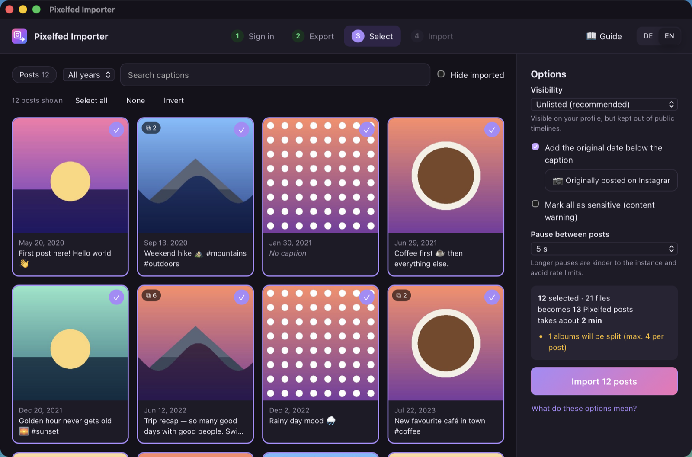
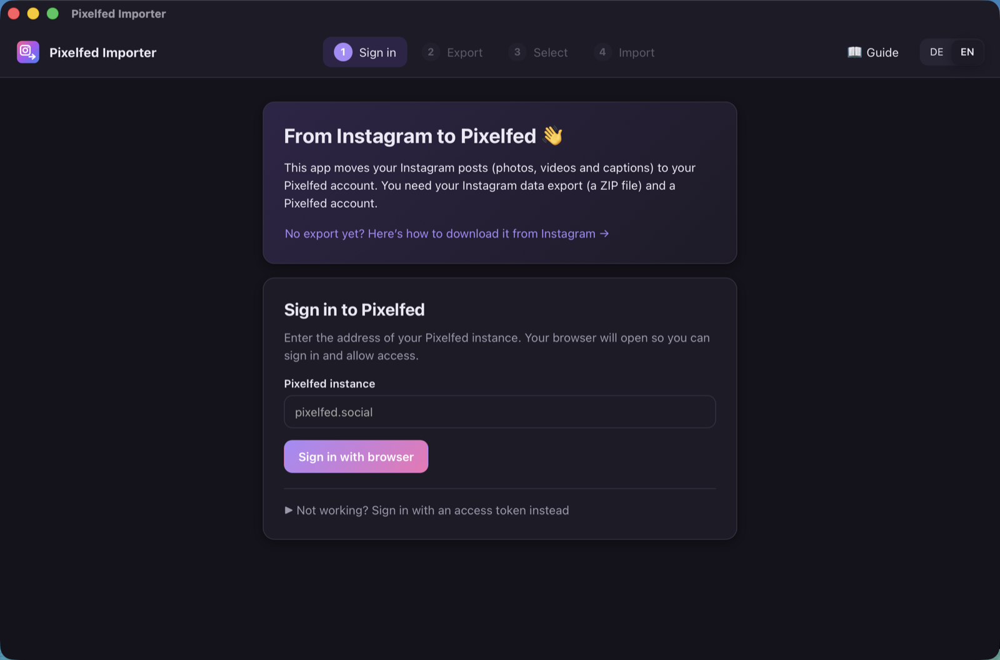
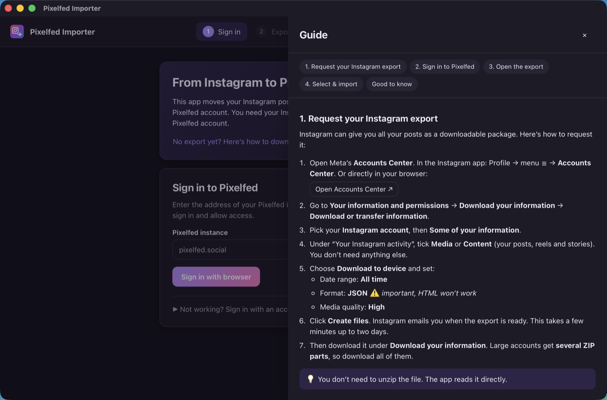
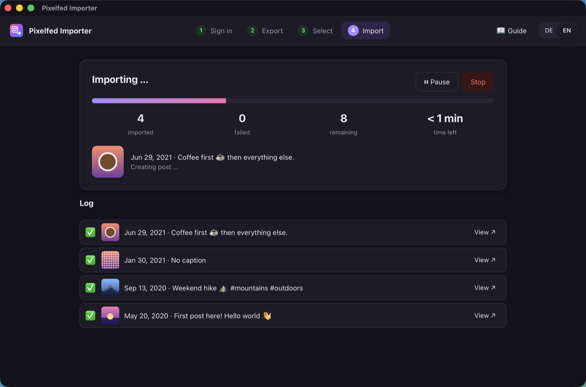

# Pixelfed Importer

Move your Instagram posts to [Pixelfed](https://pixelfed.org), including photos, albums, videos and captions. It's a small desktop app for macOS and Windows with a step-by-step guide built in. A command-line script is included too.

> **🤖 Heads-up: this project is vibecoded.**
> It was built in one evening together with an AI coding assistant ([Claude Code](https://claude.com/claude-code)). I described what I wanted and tested the result against my own account, but I didn't write every line by hand. It worked for moving my own posts. Expect rough edges, read what it's about to do, and maybe try it with a few posts first. Bug reports and PRs are very welcome.



## Features

- **Sign in with your browser:** enter your instance, log in, click *Authorize*, done. A personal access token works as a fallback.
- **Open the Instagram ZIP directly.** No unpacking needed. Exports split into several parts and unpacked folders work too, and you can drag & drop them.
- **Preview & pick:** a grid of all your posts with filters by type (posts, archived, reels, IGTV), year and caption text. Click a post to see the final caption exactly as it will appear on Pixelfed.
- **Respects your instance's limits:** albums with more photos than allowed are split into *(1/2)*, *(2/2)* posts, captions that are too long get shortened, and unsupported or oversized files are skipped and reported.
- **Original date in the caption:** Pixelfed's API can't backdate posts, so the app can add *"📷 Originally posted on Instagram on …"* below each caption. You can edit or turn off that text.
- **Oldest first,** so your profile ends up in the right order.
- **Pause, stop, resume:** the app remembers what it already imported (per Pixelfed account). Close it whenever you like and pick up where you left off, without duplicates.
- **Handles rate limits:** if the server slows you down, the app waits and retries on its own.
- **Built-in guide** covering how to request your Instagram export, sign in, the options and an FAQ.
- **German & English** UI, following your system language.
- **Private:** your data only goes from your computer to your Pixelfed instance. There's no server in between, no tracking and no analytics.

| Sign in | Built-in guide | Importing |
|---|---|---|
|  |  |  |

## Download

Grab the latest version from [**Releases**](../../releases/latest):

| System | File |
|---|---|
| macOS (Apple Silicon & Intel) | `PixelfedImporter-<version>-macOS-universal.dmg` |
| Windows 10/11 (64-bit) | `PixelfedImporter-<version>-Windows-x64-setup.exe` |

The apps are **not code-signed** (that costs money every year), so your system will warn you the first time:

- **macOS:** open the DMG, drag the app to *Applications*, then **right-click → Open** the first time. If macOS says the app is "damaged", run
  `xattr -dr com.apple.quarantine "/Applications/Pixelfed Importer.app"` in Terminal.
- **Windows:** SmartScreen shows *"Windows protected your PC"*. Click **More info → Run anyway**.

Linux isn't built yet, but the code is cross-platform. See [Build from source](#build-from-source).

## How to use it

1. **Request your Instagram data** in the Accounts Center: *Your information and permissions → Download your information → Download or transfer information*. Choose your account, then *Some of your information → Media/Content*. Pick **Download to device**, date range **All time**, format **JSON** (important, HTML won't work) and media quality **High**. Instagram emails you when it's ready, which can take minutes or up to a couple of days.
2. **Open Pixelfed Importer** and sign in to your Pixelfed instance.
3. **Choose the ZIP file(s)** you downloaded.
4. **Pick posts and options**, then hit **Import**.

All of this is explained in more detail in the app's **📖 Guide**.

### Good to know

- **Dates:** posts appear with the import date on Pixelfed. That's an API limitation. The original date goes into the caption.
- **Visibility:** *Unlisted* (the default) shows the posts on your profile without flooding public timelines and your followers' feeds with hundreds of old posts.
- **Not imported:** stories, comments, likes, followers and locations.
- **@mentions** in captions point to Pixelfed users with the same name, not to the Instagram accounts.

## Command-line script

If you prefer the terminal, [`cli/ig2pixelfed.py`](cli/ig2pixelfed.py) does the same job for an unpacked export. It needs [uv](https://docs.astral.sh/uv/) and installs its own dependency.

```sh
export PIXELFED_TOKEN=...            # Settings → Applications → Personal Access Token (read + write)
cd cli
./ig2pixelfed.py ~/Downloads/instagram-yourname-2026-01-01-abc \
  --instance https://pixelfed.social \
  --include posts,archived,reels,igtv --visibility unlisted --dry-run
```

Drop `--dry-run` to really post, and add `--limit 3` for a first test. Progress goes to `ig2pixelfed-state.json`, so re-running the command continues where it stopped. See `./ig2pixelfed.py --help` for all options.

## Build from source

You need [Rust](https://rustup.rs), [Node.js](https://nodejs.org) and the [Tauri prerequisites](https://tauri.app/start/prerequisites/) for your OS.

```sh
cd app
npm install
npx tauri dev       # run in development mode
npx tauri build     # build an installer for your current system
```

<details>
<summary>Cross-building the Windows installer on a Mac</summary>

```sh
brew install nsis llvm
cargo install --locked cargo-xwin
rustup target add x86_64-pc-windows-msvc
PATH="/opt/homebrew/opt/llvm/bin:$PATH" npx tauri build --runner cargo-xwin --target x86_64-pc-windows-msvc --bundles nsis
```
</details>

Tip for release builds: Rust embeds source paths (including your home folder) into the binary. Strip them with
`export RUSTFLAGS="--remap-path-prefix=$HOME=/home"` before building.

### Project layout

```
app/
  src-tauri/src/
    export.rs     reads the Instagram export (ZIP/folder, multi-part), fixes Instagram's broken UTF-8
    pixelfed.rs   Mastodon-compatible Pixelfed API client, OAuth via loopback redirect
    importer.rs   import loop: uploads, album splitting, caption limits, retries, pause/stop
    store.rs      settings and the list of already imported posts (per account)
    lib.rs        Tauri commands + igmedia:// protocol that serves resized thumbnails
  ui/             plain HTML/CSS/JS, no build step; all texts and the guide live in i18n.js
cli/
  ig2pixelfed.py  standalone command-line version
```

Run the Rust tests with `cd app/src-tauri && cargo test`.

## License

[MIT](LICENSE). Not affiliated with Instagram, Meta or the Pixelfed project.
